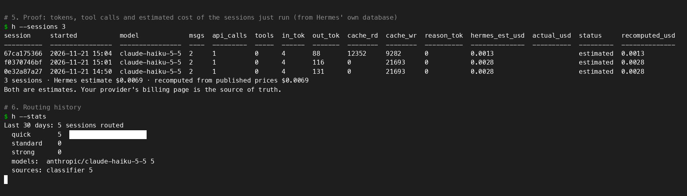

# hermes-budget-router

**Spend less on AI agents without getting worse answers.** A budget-aware model router and setup guides for [Hermes Agent](https://hermes-agent.nousresearch.com), for any provider: Claude, OpenAI, Gemini, Grok, OpenRouter, or fully local.

> Anyone can describe a cost-control framework. This one is a working tool, built while fixing a real setup. Try it.
> By Raja Shahnawaz Soni · MIT licence · v0.3


<sub>A real, unedited run on Hermes v0.23.3 (21 Nov 2026), recorded with asciinema. [MP4](docs/demo/demo.mp4) · [how to record your own](docs/demo/README.md) · [every number, sourced](docs/EVIDENCE.md)</sub>

---

## Why this exists

1. **The model is fixed for the whole session, and switching mid-session is expensive.** Hermes can't change model in the middle of a reply. If you change it mid-conversation, the prompt cache is thrown away and you pay for the full context again. So the right moment to pick a model is **before** the session starts.
2. **For short questions, the model is most of the bill.** Every new Hermes session sends ~22K tokens of setup (system prompt, tools, skills) before it reads your question. In our measured sessions, a direct one-line answer cost **$0.11 on Opus 5.5 and $0.0028 on Haiku 5.5**, about 40× apart ([evidence](docs/EVIDENCE.md) #7–8, #14).
3. **Tool loops multiply it.** Every tool call resends the context. An Opus session that made 10 API calls and 12 tool calls cost **$0.36**, ~3× a direct answer. Starting the next session within Anthropic's 5-minute cache window cut a repeat question from $0.0028 to **$0.0013** (#15).
4. **People pay for capacity they never use.** Claude Max/Ultra plans include $100–$200 a month of API credit that most agent setups never reach ([guide](docs/guides/claude-api-credits.md)).

## Which setup are you?

| You have… | Start here | Cost |
|---|---|---|
| **Claude Max, Ultra or Team** | [Claude credits guide](docs/guides/claude-api-credits.md) · `h --init claude-credits` | Included $100–$200/month |
| **Claude Pro or Free** | [Other setups](docs/guides/other-setups.md#claude-pro-or-free) · `h --init claude-paygo` | Pay-as-you-go, your cap |
| **ChatGPT plan** | [Other setups](docs/guides/other-setups.md#chatgpt-plan) · `h --init chatgpt-plan` | Within your plan |
| **SuperGrok / X Premium+** | [Other setups](docs/guides/other-setups.md#supergrok-or-x-premium) | Within your plan |
| **An OpenAI, Gemini or xAI API key** | [Other setups](docs/guides/other-setups.md#pay-as-you-go-api-keys) · `h --init openai-api` / `gemini-api` / `xai` | Pay-as-you-go |
| **No budget at all** | [Other setups](docs/guides/other-setups.md#zero-budget) · `h --init gemini-free` or `local-ollama` | $0 |
| **A bit of everything** | `h --init mixed-budget`: local for quick tasks, free Gemini for routine work, paid Claude only for hard tasks | Lowest paid spend |

**Only the Claude-credits path has been tested end to end.** The other presets use model IDs taken from each provider's pricing page in Nov 2026. `h --check` checks them against your provider before you rely on them. Reports from other setups are welcome as issues.

---

## `h`: the launcher

### What it does

1. **Routes:** one tiny call to your cheapest model sorts the task into **quick / standard / strong**. When unsure, it picks the cheaper tier. If the call fails, it falls back to keyword rules, so it never blocks you.
2. **Budget-aware:** it reads this cycle's spend from Hermes' own database. If you're on pace to overspend, the router is stricter about the strong tier. If unused credit is about to expire, it leans stronger. It never downgrades silently.
3. **Mixes providers:** each tier is a `(provider, model)` pair, so quick tasks can stay local and only hard ones reach a paid model.
4. **Logs:** every decision goes to `~/.hermes/h-routing.jsonl` for `--stats`.
5. **Launches** `hermes chat --provider … --model … -q "<your task>"`, so your task arrives as the first message and the chat stays open.

### Install

```bash
git clone https://github.com/RajaMDM/hermes-budget-router ~/.local/share/hermes-budget-router
mkdir -p ~/bin && ln -sf ~/.local/share/hermes-budget-router/bin/h ~/bin/h
grep -q 'HOME/bin' ~/.zshrc || echo 'export PATH="$HOME/bin:$PATH"' >> ~/.zshrc
source ~/.zshrc

h --presets                 # see the options
h --init claude-credits     # or any preset; writes ~/.hermes/h.json
h --check                   # keys present? models exist at the provider?
```

Needs Python 3.9+ and Hermes on your PATH. API keys are read from your environment or `~/.hermes/.env`, the same place Hermes reads them.

### Commands

| Command | What it does |
|---|---|
| `h <task>` | Route, then launch Hermes |
| `h` | Prompt for the task (handy for long or punctuation-heavy tasks) |
| `h -q / -s / -o <task>` | Force quick / standard / strong |
| `h -n <task>` | Dry run: show the decision only |
| `h --init <preset>` · `h --presets` | Set up from a preset |
| `h --check` | Verify each tier: key present, model offered by the provider |
| `h --budget` | Cycle spend, days left, projected spend |
| `h --stats` | Routing mix and models used, last 30 days |
| `h --sessions [N] [--csv]` | Last N Hermes sessions: tokens, cache use, tool calls, Hermes' cost estimate **and an independent recomputation from published prices** (titles hidden unless `--titles`) |
| `h --eval tasks.txt > routes.csv` · `h --score routes.csv` | Measure routing accuracy against your own labels |

Quote tasks containing `? * ! $ '`, e.g. `h "what's the cost?"`.

### Config: `~/.hermes/h.json`

```json
{
  "budget_usd": 20,
  "cycle_day": 1,
  "classifier_tier": "s",
  "tiers": {
    "q": {"label": "local small", "provider": "custom",    "model": "your-ollama-tag"},
    "s": {"label": "Gemini Flash", "provider": "gemini",   "model": "gemini-3.5-flash"},
    "o": {"label": "Claude Sonnet","provider": "anthropic","model": "claude-sonnet-5-5", "reasoning": "high"}
  }
}
```

- `provider` is the Hermes provider ID (`anthropic`, `openai-api`, `gemini`, `xai`, `openrouter`, `deepseek`, `custom`, `openai-codex`, `xai-oauth`, …).
- `budget_usd: null` turns budget tracking off (free and local setups).
- `classifier_tier` is the tier whose model does the routing. h falls through to any tier it can reach.
- Subscription sign-ins (`openai-codex`, `xai-oauth`, `copilot`) can be **launched** but can't run the classifier. Add one API-key tier, or let h use keyword rules.
- Other OpenAI-compatible servers: add `"endpoints": {"my-provider": {"api": "openai", "base_url": "https://…/v1", "key_env": ["MY_KEY"]}}`.

- `reasoning` (optional, per tier): `none` … `ultra`, passed to `hermes chat --reasoning`. For example `low` on the quick tier and `high` on the strong one. Higher reasoning means more thinking tokens and more cost.

Environment: `H_PAUSE` (seconds to show the decision, default 1.5), `H_FIRST_MESSAGE_FLAG` (default `-q`; set `clipboard` on Hermes builds older than v0.23 without `-q`), `H_LOG_TASKS=0`, `H_DEBUG=1`.

### Proof, not promises

`h --sessions` puts Hermes' own cost estimate next to an independent recomputation from the provider's published prices:



The second row is a fresh session ($0.0028: ~21.7K setup tokens written to cache). The first started three minutes later and reused 12,352 of those tokens from Anthropic's 5-minute cache, for $0.0013.

### Measure before you trust it

```bash
h --eval examples/tasks.txt > routes.csv     # fill the 'expected' column with q / s / o
h --score routes.csv
# 30 labelled tasks: 24 exact (80%), 3 under-routed (quality risk), 3 over-routed (cost waste)
```

---

## Also in this repo

| | |
|---|---|
| [`soul/cost-policy.md`](soul/cost-policy.md) | A short block for Hermes' `SOUL.md`: caps tool calls on simple questions, offers paid upgrades **with a price** instead of applying them, and adds a model + cost footer |
| [`scripts/aux-to-cheap.sh`](scripts/aux-to-cheap.sh) | Moves Hermes' routine background tasks (compression, titles, memory, search) to a cheap model. Keeps `approval` on the strong one |
| [`docs/guides/`](docs/guides) | Setup guides, with screenshots for the Claude path |
| [`docs/DEFENSE_BRIEF.md`](docs/DEFENSE_BRIEF.md) | Why each design choice was made, and what was rejected |

## Limits, stated plainly

- **Cheaper models are more literal.** In testing, "what is survivorship" sent to the quick tier came back as *survivorship bias* (statistics). The strong model had inferred the MDM meaning. Name the domain in quick questions: `h what is MDM survivorship`.

- **Cost figures are Hermes' estimates** from its own price table, not your provider's bill. Check them against your provider's console. [`docs/EVIDENCE.md`](docs/EVIDENCE.md) maps every number in this repo to its proof.
- **Needs Hermes v0.23+ for one-step launch.** Older builds lack `-q`. Use `H_FIRST_MESSAGE_FLAG=clipboard` and paste instead.
- **Routing accuracy hasn't been measured on a large task set yet.** Use `--eval` / `--score` and share your numbers.
- **Provider line-ups change monthly.** Run `h --check` after any provider announcement.

## Tests

```bash
python3 -m unittest discover -s tests     # 39 tests, no network needed
```

---

*Not affiliated with Anthropic, OpenAI, Google, xAI, OpenRouter or Nous Research. Product names belong to their owners.*
