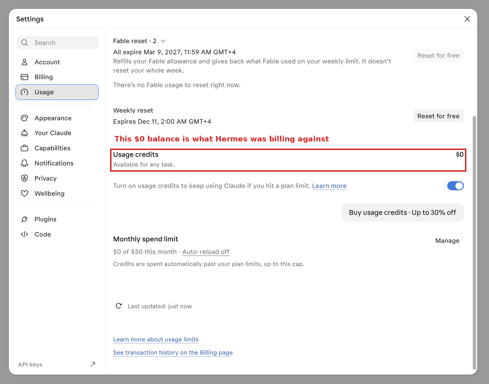
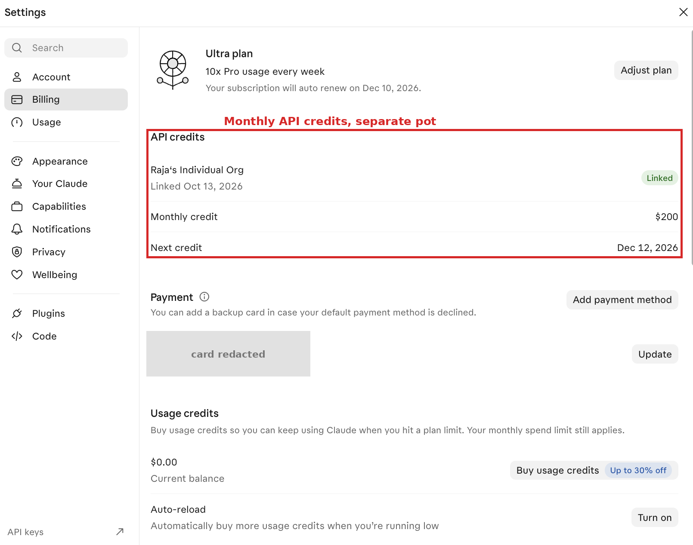
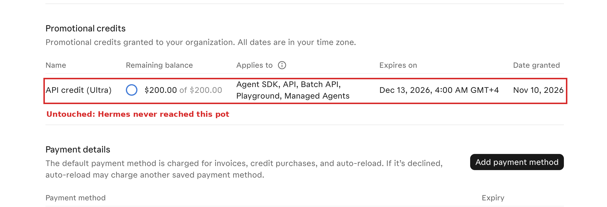
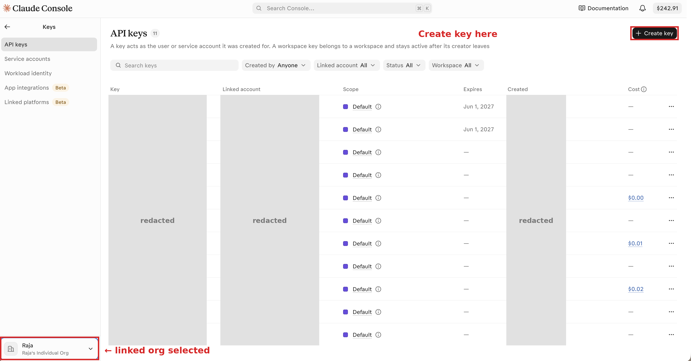
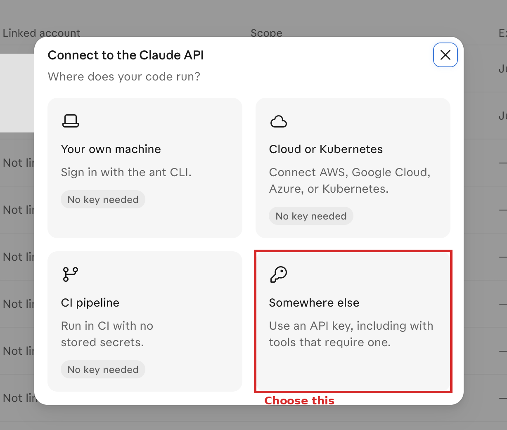
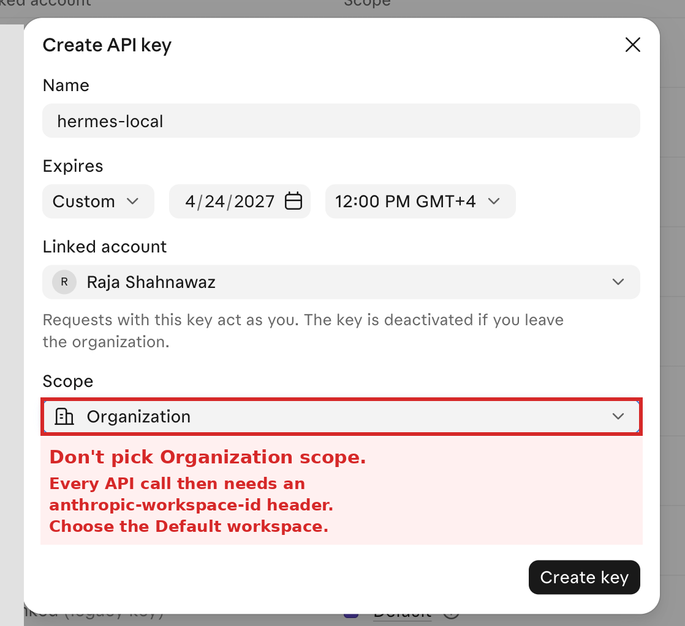

# Guide: Hermes on Claude Max / Ultra / Team API credits

**Fix "You're out of extra usage" and run [Hermes Agent](https://hermes-agent.nousresearch.com) on the monthly API credits your Claude plan already includes.** Part of [hermes-budget-router](../../README.md).

> Built and tested end to end on a real setup (Hermes v0.14 → v0.23.3, Claude Ultra, macOS), November 2026.
> By Raja Shahnawaz Soni · MIT licence

---

## Contents

1. [The symptom](#1-the-symptom)
2. [Why it happens: two separate pots of money](#2-why-it-happens-two-separate-pots-of-money)
3. [The fix, step by step](#3-the-fix-step-by-step)
4. [Troubleshooting: every error we hit](#4-troubleshooting-every-error-we-hit)
5. [Keeping costs down](#5-keeping-costs-down)
6. [`h`: the budget-aware launcher](#6-h-the-budget-aware-launcher)
7. [What's verified and what isn't](#7-whats-verified-and-what-isnt)

---

## 1. The symptom

You have a paid Claude plan with included API credits. You start Hermes and every request fails with:

```
⚠️  API call failed (attempt 1/3): BadRequestError [HTTP 400]
   🔌 Provider: anthropic  Model: claude-opus-4-7
   🌐 Endpoint: https://api.anthropic.com
   📝 Error: HTTP 400: You're out of extra usage. Add more at claude.ai/settings/usage and keep going.
```

Restarting, retrying or switching models makes no difference.

## 2. Why it happens: two separate pots of money

A Claude subscription has **two balances that never mix**:

| | **Usage credits** (claude.ai) | **Monthly API credits** (Claude Console) |
|---|---|---|
| Where | claude.ai → Settings → Usage | platform.claude.com → Billing → Promotional credits |
| Who gets it | Pay-as-you-go top-up on any paid plan | Included with Max 5x ($100), Max 20x / Ultra ($200), Team |
| How a tool reaches it | Signing in with your Claude account (OAuth) | An **API key** from the linked Console organization |
| Typical balance | **$0** unless you bought some | **$200** (Max 20x / Ultra), refreshed monthly, no rollover |

Third-party apps that sign in with your Claude account draw from the **usage credits** pot. If you never bought any, that pot is empty, so you get the 400 error. Your monthly API credits sit untouched, because Hermes never sends an API key.

**The empty pot Hermes was billing against:**



**The pot you actually want, claimed and linked on claude.ai → Settings → Billing:**



**Proof that Hermes never reached it, in the Console (Billing → Promotional credits):**



## 3. The fix, step by step

### Step 1: Claim the monthly API credits (once)

On claude.ai go to **Settings → Billing → API credits** and link a Claude Console organization. You need to be the plan subscriber, and Owner, Admin or Billing in that org.

- The link is permanent. Changing it later means contacting support, so pick a personal org you'll build in, not a work one.
- New subscribers can claim after 7 days on an eligible plan.
- Confirm the result in the Console under **Billing → Promotional credits** (screenshot above).

### Step 2: Create an API key in the *linked* org

1. In the Console, make sure the org switcher (bottom left) shows the linked org, then click **Create key**.

   

2. When asked where your code runs, choose **Somewhere else**. The other options sign in without a key, and Hermes needs a key.

   

3. Name it (e.g. `hermes-local`) and set an expiry you'll remember. For **Scope, choose the Default workspace, not Organization.** An organization-scoped key needs an `anthropic-workspace-id` header on every request, and it can also manage your whole org if it leaks.

   

4. Copy the key immediately. It is shown once.

### Step 3: Give the key to Hermes

`~/.hermes/.env` is a **file**, not a folder. Append the key without opening an editor and without putting it in your shell history:

```bash
echo "" >> ~/.hermes/.env       # make sure the key starts on its own line
cat >> ~/.hermes/.env           # paste: ANTHROPIC_API_KEY=sk-ant-...   then Enter, then Ctrl+D
chmod 600 ~/.hermes/.env
```

Check for duplicates. Our `.env` already had an empty `ANTHROPIC_API_KEY=` placeholder:

```bash
grep -n ANTHROPIC_API_KEY ~/.hermes/.env | sed 's/=.*/=****/'
# If you see two lines, inspect them without revealing the key:
sed -n '403p;405p' ~/.hermes/.env | awk -F= '{print NR": length "length($2)", starts "substr($2,1,10)}'
# Delete the empty one by line number (macOS sed needs the '' after -i):
cp ~/.hermes/.env ~/.hermes/.env.bak && sed -i '' '403d' ~/.hermes/.env
```

Make sure your shell isn't exporting a different key:

```bash
echo "shell key: ${ANTHROPIC_API_KEY:+SET}"   # should print "shell key:" with nothing after it
```

### Step 4: Remove the subscription credentials (this is the step that actually fixes it)

Adding a key isn't enough. Hermes keeps a **credential pool** and uses the first usable entry, and ours had two OAuth credentials ahead of the key:

```bash
hermes auth list
```
```
anthropic (3 credentials):
  #1  ANTHROPIC_TOKEN      oauth   env:ANTHROPIC_TOKEN ←      ← subscription token, still being used
  #2  claude_code          oauth   claude_code exhausted       ← borrowed Claude Code login
  #3  ANTHROPIC_API_KEY    oauth   env:ANTHROPIC_API_KEY       ← your key, never reached
```

Disable the token in `.env` (commented out, so you can undo it), then remove the borrowed login:

```bash
sed -i '' 's/^ANTHROPIC_TOKEN=/# ANTHROPIC_TOKEN=/' ~/.hermes/.env
hermes auth remove anthropic 1        # provider AND index are both required
hermes auth list                      # only ANTHROPIC_API_KEY should remain, with the ←
```

Stop Hermes from re-adopting your Claude Code login by adding this to `~/.hermes/config.yaml` (append it if there's no `auth:` section yet):

```bash
printf '\nauth:\n  adopt_external_logins: false\n' >> ~/.hermes/config.yaml
```

> The key shows as type `oauth` in the list even though it's an API key (newer `sk-ant-usr…` keys). It worked anyway in our test.

### Step 5: Update Hermes if it's older than the model

Old Hermes builds send a thinking parameter that current models reject:

```
HTTP 400: "thinking.type.enabled" is not supported for this model.
Use "thinking.type.adaptive" and "output_config.effort" to control thinking behavior.
```

We were on v0.14.0 (May 2026). `hermes --version` said "Up to date", which was wrong. Updating anyway pulled ~67,000 commits:

```bash
hermes update
hermes --version          # we landed on v0.23.3 (2026.9.24)
```

Then set a current model (line 2 of our config):

```bash
sed -i '' '2s/claude-opus-4-7/claude-opus-5-5/' ~/.hermes/config.yaml
```

### Step 6: Repair the gateway after a big update

If the update leaves the background gateway (Telegram etc.) failing with `service_identity_unverified`, re-register the service:

```bash
hermes gateway stop
hermes gateway uninstall
hermes gateway install
hermes gateway start
hermes gateway status     # expect: "Service definition matches the current Hermes install"
```

### Step 7: Verify

```bash
hermes chat --provider anthropic
```
```
❯ say hi in five words
☤ Hermes
Hi Raja, ready when you are.
```

Then refresh **Console → Billing → Promotional credits**. The balance should drop slightly below $200.00. If it does, Hermes is spending the right pot.

**Clean up:** delete the backups (they contain old tokens), and once you're confident, delete the commented `# ANTHROPIC_TOKEN=` line too.

```bash
rm ~/.hermes/.env.bak ~/.hermes/config.yaml.bak
```

## 4. Troubleshooting: every error we hit

| Error / symptom | Cause | Fix |
|---|---|---|
| `You're out of extra usage` (400) | Hermes authenticating with subscription OAuth | Step 4: remove `ANTHROPIC_TOKEN` and `claude_code` from the pool |
| `"thinking.type.enabled" is not supported` (400) | Hermes older than the model | Step 5: `hermes update` |
| `hermes --version` says "Up to date" on an old build | Stale version check | Run `hermes update` anyway |
| `Gateway inaccessible: service_identity_unverified` | Service registered by the old version | Step 6 |
| `warning: Failed to parse pyproject.toml … exclude-newer = "3 days"` | `uv` too old to read relative dates | Harmless for us. If deps fail, `brew upgrade uv` or `uv self update` |
| `Web UI npm install failed` | Probably an old Node.js | Optional. The CLI works without it |
| `hermes auth remove: error: … required: target` | Wrong syntax | `hermes auth remove <provider> <index>` |
| `cd: not a directory: ~/.hermes/.env` | `.env` is a file | Use `cat >>`, `grep`, `sed` on it as shown |
| nano/pico shortcuts don't work on macOS | macOS ships `pico` as `nano` | Avoid the editor and use the `cat >>` method |

## 5. Keeping costs down

API credits are charged at API prices, so how Hermes works matters more than which plan you're on.

### What actually drives cost

Numbers from our first sessions (Hermes' own estimates):

| Session | Model | Tool calls | Est. cost |
|---|---|---|---|
| 2 questions answered by "researching" (docs fetches, greps, DB query) | Opus 5.5 | 20 | ~$0.38 |
| One-paragraph definition, answered directly | Opus 5.5 | 0 | ~$0.02 |
| Same kind of question, plus a per-task cost lookup | Opus 5.5 | 1 | ~$0.06 |

Every tool call resends the whole context, so **the number of tool calls usually drives cost more than the choice of model.** Per [Anthropic's pricing](https://platform.claude.com/docs/en/about-claude/pricing) (Nov 2026): Opus 5.5 is $4/$20 per million input/output tokens, Sonnet 5.5 $2/$10 (exactly half), and Haiku 5.5 $0.10/$0.50 for prompts up to 100K tokens (40× cheaper than Opus). Reproduce our session numbers with `h --sessions` ([evidence](../EVIDENCE.md)).

### Move background tasks to Haiku

Hermes runs background tasks (compression, titles, memory, search…) on your main model by default. [`scripts/aux-to-cheap.sh`](../../scripts/aux-to-cheap.sh) moves the routine ones to Haiku and leaves safety-relevant ones (`approval`), `vision` and unknown ones alone:

```bash
bash scripts/aux-to-cheap.sh anthropic claude-haiku-5-5   # backs up config.yaml first, prints the result
```

### Give Hermes a cost policy

[`soul/cost-policy.md`](../../soul/cost-policy.md) is a short block for `~/.hermes/SOUL.md`. It caps tool calls on simple questions, makes Hermes offer (never apply) "spend more for a better result" options with a price, and adds a footer with the model and cost. With the policy in place, a definition question cost ~$0.02 and made no tool calls. The unconstrained session above cost ~$0.38.

## 6. `h`: the budget-aware launcher

See the [main README](../../README.md#h-the-launcher). For this setup: `h --init claude-credits`.

## 7. What's verified and what isn't

**Verified in this setup:** every command, error and fix in sections 1–4. Hermes v0.23.3 working against the API key. `h --check` confirming key and all three models. `h` routing a definition to Haiku, reading the real cycle spend from `state.db`, and opening Hermes with the question already sent via `-q`.

**Not verified / your mileage may vary:**
- **Budget figures** come from Hermes' own price table, not the Console. Compare them with the Console for a day before trusting them. Reading the real balance needs an admin key, which we deliberately don't give an agent.
- **The `state.db` schema** is detected at runtime. If `h --budget` says unavailable, run `H_DEBUG=1 h --budget` and open an issue.
- **Auth style:** `h` tries `x-api-key`, then `Bearer`, because Hermes labels `sk-ant-usr` keys as OAuth. It's not confirmed which one succeeds for every key type.
- **Pricing, plan credits and Hermes behaviour change.** Check [Anthropic's docs on API credits](https://platform.claude.com/docs/en/about-claude/api-credits-for-subscribers) and your Hermes version.
- **Classifier accuracy** hasn't been measured on a large task set yet. Use `--eval` / `--score`.

